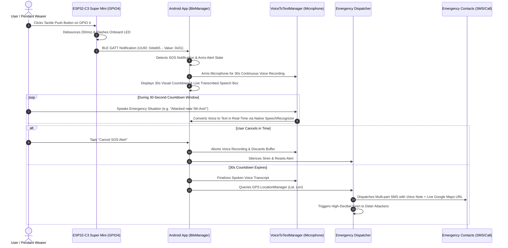

# 🛡️ Real-Time Crime Monitoring System: Crime Alert Pendant

<p align="center">
  
  
  
  
  
</p>

<p align="center">
  <strong>A wireless IoT personal safety ecosystem uniting an ESP32-C3 wearable pendant with an Android emergency companion app. When the pendant's push button is clicked, an immediate BLE signal triggers an SOS countdown, audible alarm siren, real-time GPS location lookup, and automated emergency SMS broadcast.</strong>
</p>

---

## 📌 Table of Contents

- [Key Highlights](#-key-highlights)
- [System Architecture & Data Flow](#-system-architecture--data-flow)
- [Hardware Setup & Wiring](#-hardware-setup--wiring)
- [BLE Protocol Specifications](#-ble-protocol-specifications)
- [Repository Structure](#-repository-structure)
- [Getting Started](#-getting-started)
  - [1. Flashing the ESP32-C3 Super Mini](#1-flashing-the-esp32-c3-super-mini)
  - [2. Building the Android App](#2-building-the-android-app)
  - [3. Browser-Based Hardware Testing](#3-browser-based-hardware-testing)
- [Android Application Features](#-android-application-features)
- [Emergency Dispatch Logic](#-emergency-dispatch-logic)
- [Tech Stack](#-tech-stack)
- [Academic Project Information](#-academic-project-information)

---

## ⚡ Key Highlights

- **One-Click Hardware Trigger:** A tactile push button connected to **GPIO 4** on the ESP32-C3 Super Mini activates emergency alerts instantly.
- **Ultra-Low Latency BLE 5.0:** Millisecond response time with GATT notification architecture designed for minimal battery consumption.
- **Visual Feedback:** Onboard multi-strobe LED (GPIO 8) confirms connection state and alert transmission.
- **🎙️ Real-Time 30-Second Voice-to-Text Recording:** When SOS triggers, the phone microphone immediately starts continuous 30-second recording, converts the victim's spoken voice to text in real-time (`VoiceToTextManager`), and embeds the voice transcript directly into the outgoing emergency SMS!
- **Android Companion App:** Built with **Jetpack Compose** & **Material 3**, featuring a pulsing SOS animation, real-time live transcription card, audio waveform bars, and tab navigation.
- **Live GPS Emergency Dispatch:** Fetches real-time latitude/longitude coordinates and attaches Google Maps links (`https://maps.google.com/?q=lat,lng`) to outgoing alert messages.
- **Guardians Network:** Manage up to **6 emergency contacts** with one-tap calling and automated multi-part SMS dispatch.
- **Configurable Countdown Window:** User-adjustable cancellation window (default 30s for voice note) to abort accidental triggers.
- **Web Bluetooth & Speech Diagnostic Suite:** Includes an in-browser Web BLE tester with Web Speech API to test hardware & voice recording in Google Chrome/Edge without compiling mobile code.

---

## 🔄 System Architecture & Data Flow



---

## 🔌 Hardware Setup & Wiring

The system uses the compact **ESP32-C3 Super Mini**, an ultra-small form-factor RISC-V board with integrated 2.4 GHz Wi-Fi and Bluetooth 5 (LE).

### Pin Connection Diagram

```
       ESP32-C3 Super Mini                     Momentary Push Button
     +---------------------+                      +---------------+
     |                     |                      |               |
     |              GPIO 4 |--------------------->|     Pin 1     |
     |                     |                      |               |
     |                 GND |--------------------->|     Pin 2     |
     |                     |                      +---------------+
     |              GPIO 8 | (Onboard Blue LED)
     +---------------------+
```

> **Note:** No external pull-up or pull-down resistor is required. The firmware activates the ESP32-C3's internal `INPUT_PULLUP` resistor. GPIO 4 stays `HIGH` at rest and goes `LOW` when pressed.

### Onboard LED Status (GPIO 8)

| LED State | Status Meaning |
| :--- | :--- |
| **Slow Blink (~0.7s interval)** | Disconnected / Bluetooth advertising (waiting for phone). |
| **Solid Blue ON** | Successfully connected to the Android mobile app. |
| **Rapid 5x Strobe Flash** | Push button on GPIO 4 pressed; SOS signal transmitted! |

---

## 📡 BLE Protocol Specifications

The pendant operates as a GATT Server advertising the primary Crime Alert service:

| Parameter | Identifier / Value |
| :--- | :--- |
| **Advertised Device Name** | `CrimeAlertPendant` |
| **Primary Service UUID** | `4fafc201-1fb5-459e-8fcc-c5c9c331914b` |
| **SOS Characteristic UUID** | `beb5483e-36e1-4688-b7f5-ea07361b26a8` |
| **SOS Characteristic Properties** | `READ` \| `NOTIFY` \| `INDICATE` |
| **SOS Notification Payloads** | `0x01` = SOS Triggered &bull; `0x00` = Idle / Normal |
| **Diagnostics Characteristic UUID** | `beb5483f-36e1-4688-b7f5-ea07361b26a8` |
| **Descriptor (CCCD)** | `00002902-0000-1000-8000-00805f9b34fb` |

---

## 📂 Repository Structure

```
REAL TIME CRIME MONITORING SYSTEM 1/
├── app/                                       # Android Companion Application
│   ├── build.gradle.kts                       # App-level Gradle build configuration
│   └── src/main/
│       ├── AndroidManifest.xml                # Permissions (BLE, Location, SMS, Vibration)
│       └── java/com/avinash/crimealertpendant/
│           ├── MainActivity.kt                # App entry point, lifecycle & permissions
│           ├── ble/
│           │   └── PendantBleManager.kt       # BLE GATT client, scanning & notification listener
│           ├── data/
│           │   ├── EmergencyContact.kt        # Contact model (Name, Phone, Relationship)
│           │   └── SafetyPreferences.kt       # Persistent configuration & storage
│           ├── ui/
│           │   ├── HomeScreen.kt              # Dashboard, status badge & pulsing SOS button
│           │   ├── ContactsScreen.kt          # Emergency contact network CRUD (up to 6)
│           │   ├── SettingsScreen.kt          # BLE pairing, test trigger & hardware console
│           │   └── theme/                     # Colors, typography and design tokens
│           └── util/
│               └── EmergencyDispatcher.kt     # Audio siren, vibration, GPS & SMS dispatcher
├── firmware/                                  # ESP32-C3 Super Mini Firmware
│   ├── README.md                              # Detailed hardware & flashing instructions
│   └── esp32_c3_pendant/
│       └── esp32_c3_pendant.ino               # Arduino sketch with BLE GATT server & GPIO4 debounce
├── tools/
│   └── web_ble_tester.html                    # In-browser Web Bluetooth hardware test utility
├── build.gradle.kts                           # Root Gradle script
├── settings.gradle.kts                        # Gradle module settings
└── README.md                                  # Overall project documentation
```

---

## 🚀 Getting Started

### 1. Flashing the ESP32-C3 Super Mini

1. **Install Arduino IDE** (v2.x or higher) from [arduino.cc](https://www.arduino.cc/en/software).
2. **Add ESP32 Board Index**:
   - Go to **File** ➔ **Preferences**.
   - Under **Additional boards manager URLs**, add:
     ```
     https://raw.githubusercontent.com/espressif/arduino-esp32/gh-pages/package_esp32_index.json
     ```
3. **Install ESP32 Package**:
   - Go to **Tools** ➔ **Board** ➔ **Boards Manager...**, search for `esp32` by *Espressif Systems*, and click **Install**.
4. **Open the Project**:
   - Open [`firmware/esp32_c3_pendant/esp32_c3_pendant.ino`](firmware/esp32_c3_pendant/esp32_c3_pendant.ino).
5. **Set Target Board & Parameters (Tools Menu)**:
   - **Board:** `ESP32C3 Dev Module`
   - **USB CDC On Boot:** `Enabled` ⚠️ *(Crucial for USB Serial logging on Super Mini)*
   - **CPU Frequency:** `160MHz (WiFi/BT)`
   - **Flash Frequency:** `80MHz`
   - **Flash Mode:** `QIO`
   - **Flash Size:** `4MB (32Mb)`
   - **Upload Speed:** `921600` (or `460800`)
   - **Port:** Select your board's COM port.
6. **Upload Firmware:** Click **Upload** (`Ctrl + U`).
7. **Verify via Serial Monitor:** Open **Tools** ➔ **Serial Monitor** at **115200 baud**. Press the push button on GPIO 4 to verify the `[ALERT] GPIO4 BUTTON PRESSED!` event.

---

### 2. Building the Android App

1. Open this repository root in **Android Studio** (Koala / Ladybug or newer recommended).
2. Allow Gradle to synchronize dependencies.
3. Connect your Android phone via USB (with **USB Debugging** enabled) or start an Android 12+ emulator.
4. Click **Run 'app'** (`Shift + F10`).
5. When the app opens, allow the requested runtime permissions:
   - **Nearby Devices / Bluetooth:** For BLE scanning and GATT connection.
   - **Location:** For GPS coordinates in emergency messages.
   - **SMS & Phone (Optional):** For automated SMS broadcast and direct dialing.
6. The app will immediately search for `CrimeAlertPendant` and display **CONNECTED (ESP32-C3 Online)**.

---

### 3. Browser-Based Hardware Testing

You can verify your ESP32-C3 pendant without compiling the Android app:

1. Open Google Chrome or Microsoft Edge.
2. Double-click or open [`tools/web_ble_tester.html`](tools/web_ble_tester.html).
3. Click **Pair & Connect ESP32**.
4. Select `CrimeAlertPendant` from the browser pop-up.
5. Click the push button on **GPIO 4**: the web console will instantly sound an alarm and display the incoming BLE notification with timestamp and latency.

---

## 📱 Android Application Features

### 🏠 Home Dashboard
- **Pendant Status Monitor:** Real-time connection badge (`ONLINE`, `SCANNING`, `DISCONNECTED`) with 1-click connect/disconnect.
- **Pulsing SOS Button:** Large circular target with dynamic haptic feedback and reverse-scale pulsing animation during active alerts.
- **Trigger Source Attribution:** Distinctly displays whether the alert was initiated by `ESP32-C3 Push Button (GPIO4)` or `Manual In-App Button`.
- **Active Countdown & Abort:** Immediate countdown timer with a prominent **Cancel SOS Alert** button to prevent false alarms.

### 👥 Emergency Contacts Network
- Store up to **6 trusted contacts** locally on the device.
- Direct phone dialer integration (`ACTION_DIAL`).
- Automated multi-part SMS dispatch populated with the victim's live GPS coordinates.

### ⚙️ Settings & Diagnostic Console
- **Hardware Config:** Target Bluetooth device name filter and Bluetooth scanner.
- **Simulation Mode:** In-app "Simulate GPIO4" button to test the complete dispatch pipeline without hardware connected.
- **Response Preferences:** Toggle audible siren sound, vibration pulses, auto-SMS dispatch, and adjust the cancellation countdown window (5s to 60s).
- **Live Event Log:** Terminal-style console displaying every BLE packet, MTU handshake, and hardware event in real-time.

---

## 🚨 Emergency Dispatch Logic

When the countdown reaches `0`:

```
=========================================
🚨 EMERGENCY ALERT DISPATCHED
=========================================
Message: EMERGENCY! I need immediate help. Sent from Crime Alert Pendant.

🎙️ Voice Note: "Attacked near 5th avenue metro station, need police immediately!"

📍 Location: https://maps.google.com/?q=17.3850,78.4867
Recipients: 6 Contacts
Status: Multi-part SMS Broadcast Sent + Continuous Audio Siren Active
=========================================
```

---

## 🛠️ Tech Stack

- **Microcontroller:** ESP32-C3 Super Mini (Single-core RISC-V 160MHz)
- **Firmware Environment:** Arduino ESP32 Core v3.x, `BLEDevice`, `BLEServer`, `BLE2902`
- **Mobile Platform:** Android (minSdk 24, targetSdk 37)
- **UI Framework:** Kotlin, Jetpack Compose, Material Design 3
- **Reactive Architecture:** Kotlin Coroutines, `StateFlow`, `SharedFlow`
- **Android APIs:** `BluetoothLeScanner`, `BluetoothGatt`, `LocationManager`, `SmsManager`, `VibratorManager`
- **Testing Tools:** Web Bluetooth API (HTML5, JavaScript ES6)

---

## 🎓 Academic Project Information

- **Project Title:** Real-Time Crime Monitoring System: Crime Alert Pendant
- **Domain:** Internet of Things (IoT) & Mobile Application Development
- **Category:** Engineering Major / Capstone Project
- **Purpose:** Developed and submitted in fulfillment of academic requirements, demonstrating IoT-to-Mobile communication, BLE GATT protocol implementation, and real-time personal safety dispatch mechanisms.

> ⚠️ **Academic Notice:** This project was developed for college academic submission, evaluation, and research purposes. All rights reserved by the student project authors and academic institution.
